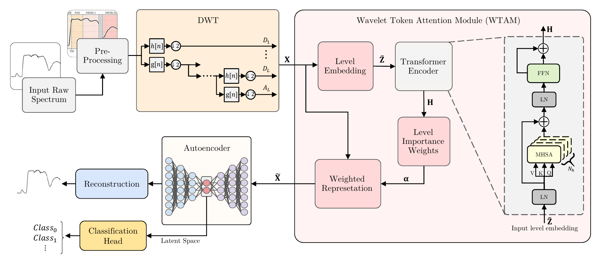

# HS-WAE: A Pipeline for Early Insect Damage Detection in Hyperspectral Soybean Data by Enhanced Deep Autoencoder

[][ieee-paper]
[](LICENSE)

Official repository of "[HS-WAE: A Pipeline for Early Insect Damage Detection in Hyperspectral Soybean Data by Enhanced Deep Autoencoder][ieee-paper]", accepted in **IEEE Transactions on Artificial Intelligence**. IEEE Xplore link coming soon.

**Authors:** André Oliveira Françani, Liang Zhao, João de Deus Ferreira e Silva, Kaizhou Gao, and Lúcio André de Castro Jorge.

## Abstract

*Early detection of pest-induced stress in soybean plants is challenging since spectral differences are subtle during the initial stages of infestation. This work proposes HS-WAE, a spectral deep learning pipeline combining spectral band grouping, discrete wavelet transform (DWT), a wavelet token attention module (WTAM), and an autoencoder-based classifier. DWT provides a multiscale spectral representation, while WTAM adaptively weights the resulting wavelet levels for each sample before latent-space compression and classification. The method was evaluated on a soybean dataset acquired over seven consecutive days after infestation, considering multiple spectral regions and repeated runs with statistical analysis. The results show that DWT is a key component, significantly outperforming the raw spectral input and enabling earlier discrimination between control and damaged plants. In the near-infrared (NIR) region, HS-WAE achieved 97.2% accuracy, 97.9% F1-score, and 100.0% AUROC on day 02, and perfect metrics on day 03, whereas the raw spectral input achieved its best NIR performance only later. The WTAM further refines the DWT representation through sample-specific wavelet-level weighting, with repeated-run latent-space and counterfactual analyses confirming its functional relevance, particularly in the more challenging multiclass setting. Experiments on the public HyperBlood dataset also show that the proposed pipeline generalizes to a different hyperspectral domain and multiclass setting. Overall, DWT-based spectral representations provide substantial advantages over raw spectra in informative spectral regions, and HS-WAE is effective for early pest-damage detection in soybean plants.*



## Contents

1. [Dataset](#1-dataset)
2. [Pre-trained models](#2-pre-trained-models)
3. [Setup](#3-setup)
4. [Usage](#4-usage)
5. [Evaluation](#5-evaluation)
6. [Citation](#citation)
7. [License](#license)

## 1. Dataset

**Soybean:** available upon request. Contact **Prof. Liang Zhao** at **[zhao@usp.br](mailto:zhao@usp.br)**.

**HyperBlood:** download from [Zenodo](https://zenodo.org/records/3984905); see the [original repository](https://github.com/iitis/HSI_blood_detection) and [preparation instructions](data/README.md).

Process the annotated hyperspectral images into **one mean hyperspectral curve per object** (connected component). Averaging its pixels at each wavelength produces one labeled spectrum per CSV row, matching the soybean pipeline's sample format.

Place the processed CSVs as follows:

```text
data/HS-Class/soybean_HSI.csv
data/HSI_Blood/HSI_Blood.csv
```

## 2. Pre-trained models

Checkpoints are not included. Train a model using the commands below.

## 3. Setup

From the repository root, create and activate the Conda environment (Python 3.10):

```bash
conda env create -f environment.yml
conda activate hs-wae
python -m pip install --upgrade pip
```

Install **one** PyTorch build:

```bash
# NVIDIA GPU: CUDA 13.0 (compatible driver required)
python -m pip install torch==2.10.0 --index-url https://download.pytorch.org/whl/cu130
```

```bash
# CPU only
python -m pip install torch==2.10.0 --index-url https://download.pytorch.org/whl/cpu
```

Install the remaining dependencies:

```bash
python -m pip install -r requirements.txt
python -m pip check
```

See [environment notes](environment/README.md) for other PyTorch builds.

## 4. Usage

Use Bash (Git Bash on Windows) from the HS-WAE root. Native Python commands are in the [execution guide](RUNNING.md).

### 4.1. Training

Paper experiments: **25 repetitions, up to 300 epochs each**.

```bash
bash scripts/run_soybean.sh hswae --band_region nir --days 2 --devices 0
bash scripts/run_soybean.sh raw --band_region nir --days 2 --devices 0
bash scripts/run_hyperblood.sh hswae --band_region vis --devices 0
bash scripts/run_hyperblood.sh raw --band_region vis --devices 0
```

CPU execution:

```bash
python -m tools.configure --cpu --num-workers 0
CONFIG=configs/local/dwt_attn.yaml bash scripts/run_soybean.sh hswae --band_region nir --days 2
```

Use `--overwrite` to regenerate existing local configs. Ablations, controlled WTAM variants, and baselines are listed in the [execution guide](RUNNING.md#ablations-and-baselines).

### 4.2. Single run and checkpoint evaluation

```bash
cd HS-AE
python -m main --mode train --config configs/dwt_attn.yaml --band_region nir --days 2 --devices 0
python -m main --mode test --config configs/dwt_attn.yaml --band_region nir --days 2 --devices 0 --ckpt /path/to/model.ckpt
cd ..
```

### 4.3. TensorBoard

The standard training scripts log losses, metrics, and confusion matrices. From the HS-WAE root, in a second terminal with `hs-wae` activated:

```bash
tensorboard --logdir . --port 6006
```

Open **[http://localhost:6006](http://localhost:6006)**. Runs are stored under each project's `logs/` or `v0/logs/` directory. Controlled WTAM runs save result files without TensorBoard logging; use the [plotting commands](RUNNING.md#tensorboard-and-saved-plots).

## 5. Evaluation

```bash
python -m unittest discover -s tests -v
python -m tests.run_smoke --outdir tests/_artifacts/check01
```

Use a fresh output directory. Smoke tests check execution; paper reproduction requires full training.

## Citation

If this work supports your research, please cite the accepted paper:

> André Oliveira Françani, Liang Zhao, João de Deus Ferreira e Silva, Kaizhou Gao, and Lúcio André de Castro Jorge, “HS-WAE: A Pipeline for Early Insect Damage Detection in Hyperspectral Soybean Data by Enhanced Deep Autoencoder,” IEEE Transactions on Artificial Intelligence, accepted for publication.

```bibtex
@article{francaniHSWAE,
  author  = {Fran{\c{c}}ani, Andr{\'e} Oliveira and Zhao, Liang and
             Ferreira e Silva, Jo{\~a}o de Deus and Gao, Kaizhou and
             de Castro Jorge, L{\'u}cio Andr{\'e}},
  title   = {{HS-WAE}: A Pipeline for Early Insect Damage Detection in
             Hyperspectral Soybean Data by Enhanced Deep Autoencoder},
  journal = {IEEE Transactions on Artificial Intelligence},
  note    = {Accepted for publication}
}
```

Final publication metadata and DOI will be added when available.

## License

This project's code is released under the [MIT License](LICENSE). Third-party materials retain their original licenses; see the notices under [preprocessing/hyperblood](preprocessing/hyperblood).

## References

- [HyperBlood dataset](https://zenodo.org/records/3984905) and [HSI blood detection code](https://github.com/iitis/HSI_blood_detection).
- Dataset and loader notices are retained under [preprocessing/hyperblood](preprocessing/hyperblood).

<!-- Replace #citation below with the final IEEE Xplore article URL. -->
[ieee-paper]: #citation
